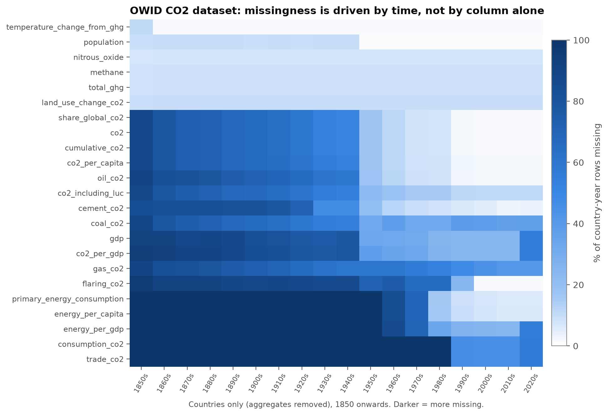
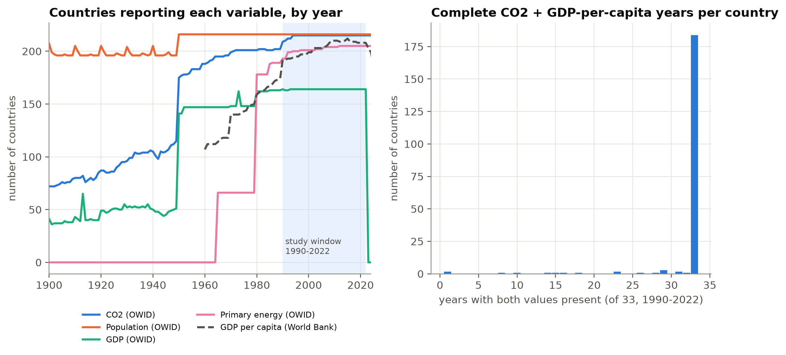
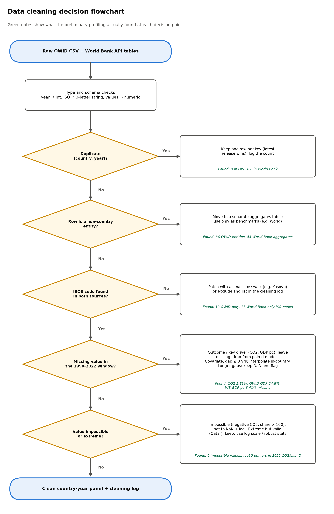
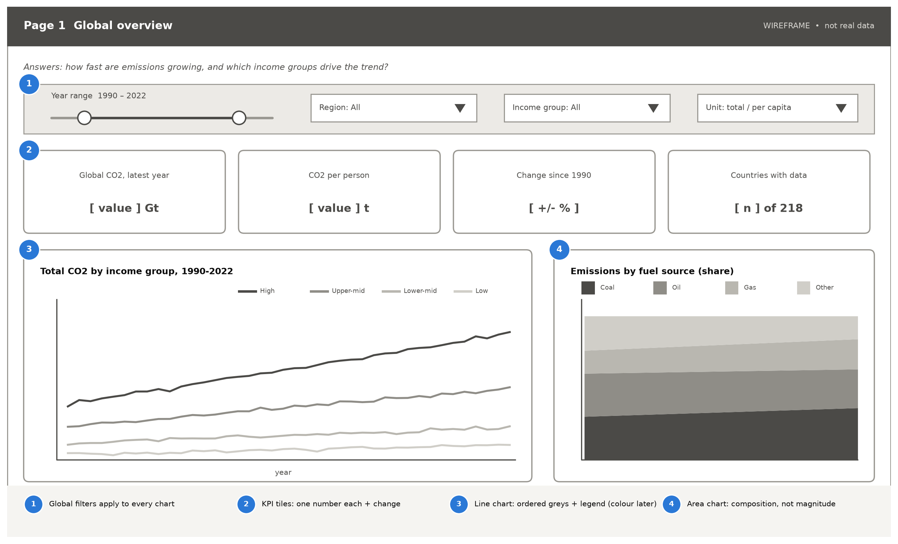
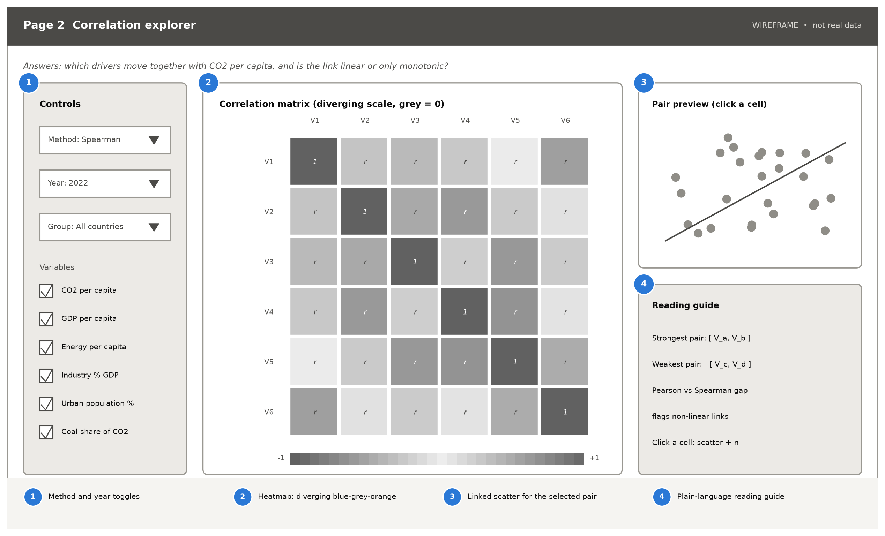
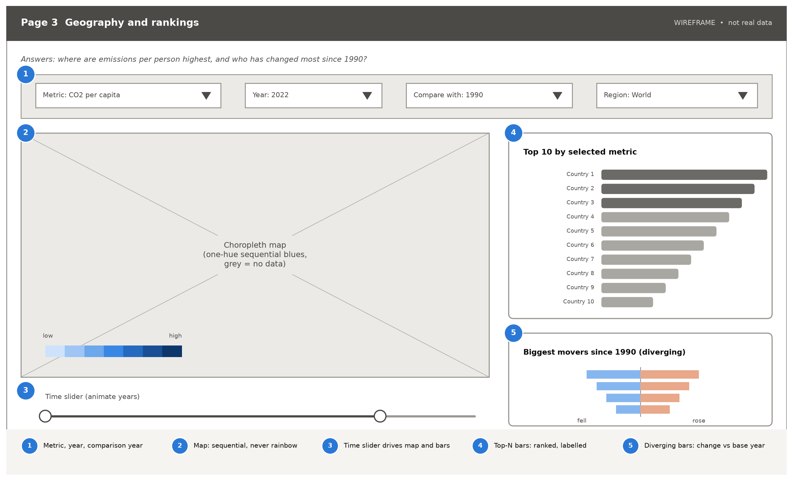
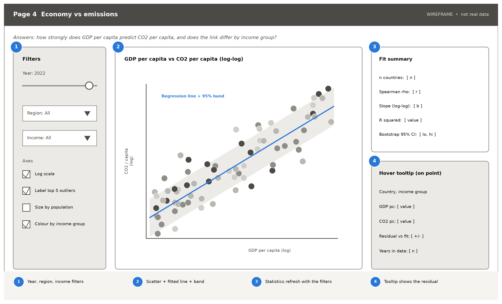
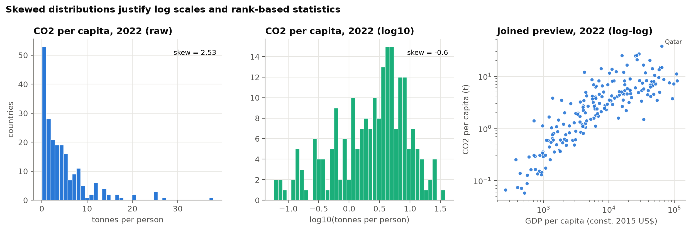
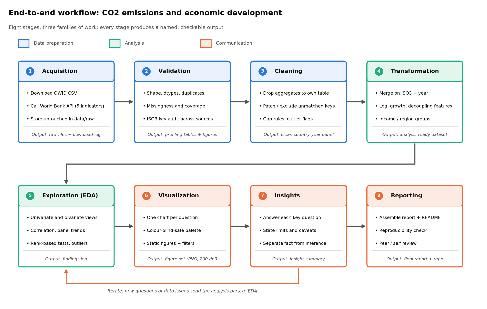
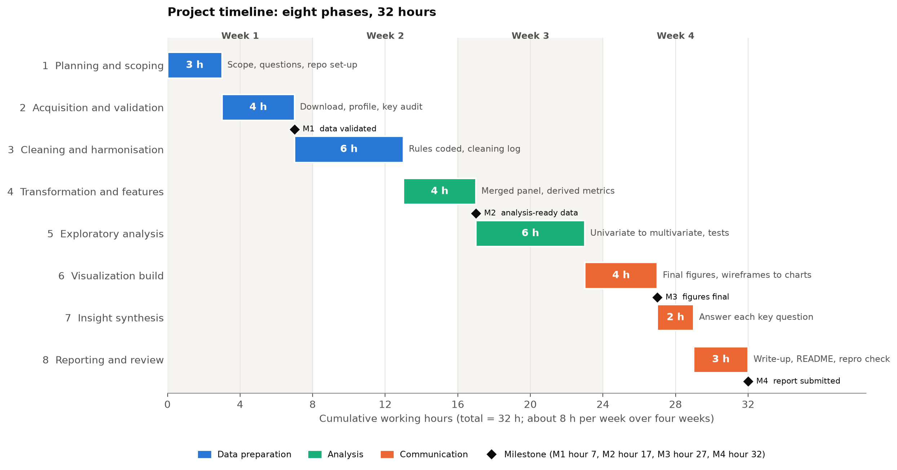

# Week 1 Task: Data Exploration and Visualization Strategy

## Does Wealth Burn Carbon? An Exploratory Data Analysis Plan for CO2 Emissions and Economic Development, 1990-2022

---

## 1. Title and Introduction

### 1.1 Project title

**Does Wealth Burn Carbon? Planning an Exploratory Analysis of CO2 Emissions and Economic Development Across 200+ Countries, 1990-2022**

### 1.2 Background

Carbon dioxide from fossil fuels and cement is the largest single driver of human-caused climate change, and the countries that emit it differ enormously in size, income and energy systems. A long-running question is whether rising income inevitably means rising emissions, or whether wealthy economies eventually "decouple" growth from carbon. The environmental Kuznets curve proposes an inverted-U between income and pollution (Grossman & Krueger, 1995), but later reviews found the evidence for carbon dioxide weak and sensitive to sample and method (Stern, 2004).

Two open, well-maintained datasets make the question testable by a student: the Our World in Data (OWID) CO2 and greenhouse gas database, which compiles national emissions from the Global Carbon Project, and the World Bank's World Development Indicators, which supply income, population and structural-economy variables. This document is the *plan* for an exploratory data analysis (EDA) built on those two sources. It does not run the full analysis. It does, however, rest on a real preliminary profiling run of both datasets, so every data-quality statement below was measured, not assumed.

### 1.3 Problem statement

Raw emissions tables are hard to interpret. Totals are dominated by a few very large economies, per-capita values by a few very small ones, the sources name countries differently, and much of the history is missing. A careless analysis would produce misleading headlines, for example by double counting regional aggregates or mixing GDP series in different price bases. The problem this project addresses is: **how can we reliably combine, clean and visualise national emissions and economic data so that the relationship between income and carbon emissions can be explored honestly, including its limits?**

### 1.4 Objectives

1. Acquire two public datasets programmatically and record their provenance, licence and quality.
2. Design a reproducible cleaning and transformation workflow grounded in measured data problems.
3. Define ten answerable questions and the exploratory methods that address each one.
4. Design a set of visualizations, with wireframes, that answer those questions clearly and accessibly.
5. Plan the work as a 32-hour project with milestones and a risk register.

The scope is deliberately limited to **exploration and description**; causal claims, forecasting and policy advice are out of scope.

---

## 2. Dataset Research and Selection

### 2.1 Selection criteria

Candidates had to be (1) free to download with no account or API key; (2) openly licensed; (3) from a named institution; (4) joinable through a shared country identifier; and (5) rich enough for univariate, bivariate, multivariate and time-series exploration. Both chosen datasets pass all five.

### 2.2 Dataset 1: Our World in Data CO2 and Greenhouse Gas Emissions

| Item | Detail |
|---|---|
| Publisher | Our World in Data (OWID), compiling data from the Global Carbon Project, Jones et al., the Energy Institute and the U.S. EIA, the Maddison Project and others |
| Access URL | `https://raw.githubusercontent.com/owid/co2-data/master/owid-co2-data.csv` (HTTP 200, verified) |
| Licence | OWID states that its data, visualizations and code are open access under Creative Commons BY; third-party inputs keep their original terms |
| Size (measured) | 14.4 MB, 50,411 rows by 79 columns |
| Time span (measured) | 1750-2024 |
| Entities (measured) | 254, of which 218 are countries with an ISO3 code and 36 are regions, groups or special entities |
| Column groups | Identifiers (country, year, `iso_code`); population and GDP; CO2 totals, per-capita and per-GDP values; CO2 by fuel (coal, oil, gas, cement, flaring); land-use-change CO2; consumption-based CO2 and trade; methane, nitrous oxide and total greenhouse gases; primary energy; cumulative and global-share measures; temperature-change attribution |
| Units | CO2 in million tonnes; per capita in tonnes per person; GDP in international-$ at 2011 prices (from the codebook) |

**Quality assessment (measured, all years, all rows).** There are no duplicate rows and no duplicate (country, year) keys. Structure is clean: 76 numeric columns of type float, one integer year, and two text columns. Completeness, however, varies sharply: 45 of 79 columns are more than 50% missing and the median column is 52.8% missing. Selected columns: population 18.3% missing, CO2 41.7%, GDP 69.8%, primary energy consumption 78.9%, consumption-based CO2 90.0%. Missingness is time-driven (Figure 2.1): within the study window 1990-2022 and for countries only, CO2 is just 1.6% missing and population 0.9%. OWID's own GDP column is 24.8% missing in the window and stops in 2022 (164 countries), so it is used only as a cross-check.

**Why it was chosen.** It is a widely used open compilation of national CO2 data, documents every variable in a public codebook, is updated regularly, and carries the ISO3 code needed for joins. At 50k rows it is realistic yet laptop-sized.

### 2.3 Dataset 2: World Bank World Development Indicators (Indicators API v2)

| Item | Detail |
|---|---|
| Publisher | The World Bank, Open Data |
| Access | Indicators API v2, `https://api.worldbank.org/v2/country/all/indicator/{CODE}?format=json&per_page=20000&date=1960:2025`; no key required (HTTP 200, verified) |
| Licence | World Bank datasets default to Creative Commons Attribution 4.0 (CC BY 4.0) |
| Indicators used | `NY.GDP.PCAP.KD` GDP per capita (constant 2015 US$); `NY.GDP.PCAP.PP.KD` GDP per capita, PPP (constant 2021 international $); `SP.POP.TOTL` population; `SP.URB.TOTL.IN.ZS` urban population (% of total); `NV.IND.TOTL.ZS` industry value added (% of GDP) |
| Size (measured) | 87,780 long-format rows (5 indicators by 266 entities by 66 years), 6.5 MB of CSV; API snapshot dated 2026-10-08 |
| Time span | 1960-2025 |
| Entities (measured) | 266, of which 44 are aggregates (regions, income groups) and 217 are countries with metadata |

**Quality assessment (measured).** No duplicate entity-year-indicator rows. No non-positive GDP or population values, and no percentage indicator outside 0-100. Missingness is moderate and again time-driven: across all years GDP per capita is 19.5% missing, PPP GDP 51.3% (the series starts only in 1990), industry share 36.8%, population 0.2% and urbanisation 0%. Inside the 1990-2022 window these fall to 6.4%, 10.6%, 15.6%, 0% and 0%. GDP per capita is reported for 208 countries in 2022, 203 in 2023 and 199 in 2024, so the most recent years are thinner.

**Why it was chosen.** It supplies what OWID lacks: a current, near-complete income measure for more countries, plus structural variables (industry share, urbanisation) that offer candidate explanations. It is institutionally maintained, openly licensed and uses ISO3 codes.

### 2.4 Comparison of the two datasets

| Criterion | OWID CO2 data | World Bank WDI |
|---|---|---|
| Role in the project | Outcome (emissions) and energy detail | Drivers (income, population, structure) |
| Format | One wide CSV | JSON API, reshaped to long and then wide |
| Granularity | Country-year | Country-year |
| Span | 1750-2024 | 1960-2025 |
| Country key | `iso_code` (blank for aggregates) | `countryiso3code` (blank for 5 income-group rows) |
| Aggregates mixed in | 36 entities (15.7% of rows) | 44 entities |
| Missing, 1990-2022 | CO2 1.6%, GDP 24.8% | GDP per capita 6.4% |
| Licence | Creative Commons BY | CC BY 4.0 |
| Main weakness | Sparse GDP, many columns largely empty | Latest years thin, regional groupings change |

### 2.5 How the datasets will be combined

The sources will be joined on **ISO3 code and year**, after aggregates are separated out of each. Country names cannot be used as the key. In the profiling run, 206 ISO3 codes were present in both sources, but only 177 country names matched exactly, so a name-based join would have silently lost 29 countries (for example `Egypt` against `Egypt, Arab Rep.`, `Cape Verde` against `Cabo Verde`, `Congo` against `Congo, Rep.`). Twelve OWID entities have no World Bank counterpart (including Taiwan, Anguilla, Niue and the Vatican) and eleven World Bank entities have no OWID counterpart (including Puerto Rico, Guam and the Cayman Islands). Kosovo is the one case worth rescuing: it carries `XKX` in the World Bank data but has no ISO code in OWID, and it has 31 non-missing CO2 observations. A small manual crosswalk will map it.

The joined preview has 6,798 country-year rows (206 countries by 33 years). Of these, 6,436 (94.7%, covering 202 countries) have both CO2 per capita and GDP per capita; 184 countries are complete in all 33 years and 197 in 2022. Population was cross-checked too: the median difference between sources is 0.001%, but 15 countries (led by Moldova, Palestine, Curacao and Seychelles) differ by more than 5% in some year, so one source will be declared and the discrepancy reported.

### 2.6 Study window decision

The analysis window is **1990-2022**. Reasons: (a) CO2 and population are almost complete from 1990; (b) the World Bank PPP series and OWID consumption-based CO2 both begin in 1990; (c) OWID's GDP column ends in 2022; (d) 1990 is a conventional baseline year for climate comparisons; and (e) the newest one or two years of any statistical release are the most likely to be revised, so they are kept out of the core window and can be added as an extension.

---

## 3. Key Questions the Analysis Will Answer

The questions are ordered from description to association to robustness. Each is answerable with the two datasets and names the evidence that will answer it.

| # | Question | Variables | Primary method |
|---|---|---|---|
| Q1 | How have total CO2 emissions changed from 1990 to 2022, globally and by World Bank income group, and which groups account for most of the growth? | CO2, income group | Indexed time series, stacked contribution |
| Q2 | In the latest complete year (2022), how strongly is GDP per capita associated with CO2 per capita across countries, and is the association monotonic rather than linear? | GDP per capita, CO2 per capita | Log-log scatter, Spearman vs Pearson |
| Q3 | Does the slope of that association differ between income groups? | Same, by group | Stratified fits, bootstrap intervals |
| Q4 | Which countries have the highest and lowest per-capita emissions, and are the highest values concentrated among small, fuel-exporting economies? | CO2 per capita, population | Ranked bars, choropleth, population overlay |
| Q5 | Which countries decoupled between 1990 and 2022, with GDP per capita rising while CO2 per capita fell? | Change in both | Decoupling quadrant plot |
| Q6 | How has carbon intensity (CO2 per unit of GDP) changed over time and by income group? | CO2, GDP, population | Time series of intensity |
| Q7 | How does the fuel mix (coal, oil, gas, cement) differ by income group and how has it shifted since 1990? | Fuel-level CO2 | 100% stacked areas |
| Q8 | After accounting for income, do industry share of GDP and urbanisation help explain differences in per-capita emissions? | Industry %, urban %, income | Partial correlation, simple log-linear model |
| Q9 | Do consumption-based emissions exceed production-based emissions in rich countries (the trade effect)? | Consumption CO2, CO2 | Paired differences, dumbbell chart |
| Q10 | How sensitive are the main findings to data choices: missing data handling, price basis (constant US$ vs PPP) and the population source? | All | Sensitivity re-runs |

Q1 to Q4 are the core; Q5 to Q8 deepen the explanation. Q9 uses a narrower subset (consumption-based CO2 exists for only 120 countries) and is labelled exploratory. Q10 tests the plan's own fragility.

---

## 4. Data Cleaning and Preparation Plan

Each rule below responds to a problem found in the preliminary profiling (`src/profile_data.py`, notebook `01_preliminary_profiling.ipynb`). The decision flow is shown in Figure 4.1.

| Step | Problem found (measured) | Technique | Justification |
|---|---|---|---|
| 1. Types | 76 float, 1 int, 2 text columns in OWID; JSON nulls from the World Bank | Cast year to int, ISO to 3-letter string, values to numeric | Silent type errors are cheap to prevent |
| 2. Duplicates | 0 duplicate keys in either source | Assert key uniqueness; if violated keep the latest and log | Protects against future data refreshes |
| 3. Aggregates | 36 OWID entities (15.7% of rows) with no ISO code, 44 World Bank aggregates, 5 income-group rows with blank ISO3 | Move to a separate table; flag `is_aggregate`; use only as benchmarks | Mixing aggregates with countries double counts emissions |
| 4. Keys | 206 ISO3 matches against 177 name matches; 12 OWID-only and 11 World Bank-only entities; Kosovo is `XKX` only at the World Bank | Join on ISO3 plus year; crosswalk for Kosovo; log all exclusions | ISO3 is stable across sources, names are not |
| 5. Missing: outcome and key driver | Window missingness: CO2 1.6%, CO2 per capita 2.5%, World Bank GDP per capita 6.4%, OWID GDP 24.8% | Never impute; drop rows from paired analyses only and report n | Imputing the outcome or main predictor would invent the relationship under study |
| 6. Missing: secondary covariates | Industry share 15.6% missing in the window | Interpolate within country for gaps of 3 years or fewer; flag; leave longer gaps | Short gaps in slow-moving shares are low-risk; flags allow the Q10 re-run |
| 7. GDP source | OWID GDP is in 2011 international-$; its per-person value is about 0.70 of World Bank PPP GDP per person (median) | World Bank GDP per capita (constant 2015 US$) as primary, PPP as sensitivity; never mix | Mixed price bases create artificial jumps |
| 8. Population source | Median gap 0.001%, but 15 countries differ by over 5% in some year | One declared source; list the 15 countries | Avoids silent inconsistency |
| 9. Impossible values | No negative CO2, population or GDP; no shares above 100 | Assertions that set violations to missing and log them | Zero today; protects later refreshes |
| 10. Legitimate negatives and zeros | Negatives in land-use change (5,708 rows) and trade (1,597); 881 country-years with exactly zero CO2 | Keep; exclude zeros only from log transforms | Real accounting outcomes, not errors |
| 11. Extremes | Raw 2022 CO2 per capita skew 2.53; 14 of 213 IQR outliers raw, 2 on log10; top: Qatar 37.9 t, Brunei 26.9, Kuwait 25.2; 57 countries under 1 million people | Keep all; log scale; rank statistics; flag small countries | Extremes are plausible fuel-exporting economies; deleting them removes information |
| 12. Window | CO2 mostly complete from 1990; OWID GDP ends 2022 | Restrict core analysis to 1990-2022 | Matches Figure 2.1 |

The output of this stage is a clean country-year panel plus a **cleaning log** that lists every row dropped, changed or flagged, with the reason. The log doubles as an audit trail for the report and the viva.

---

## 5. Transformation and Feature Engineering Plan

| Feature | Definition | Purpose and justification |
|---|---|---|
| `log_gdp_pc` | log10 of World Bank GDP per capita | GDP per capita is heavily right-skewed (skew 3.25 in 2022, roughly 0 after log); logs make relationships closer to linear and stabilise variance |
| `log_co2_pc` | log10 of CO2 per capita | Skew falls from 2.53 to -0.60; interprets as percentage differences |
| `co2_total_gdp_int` | CO2 divided by total GDP (GDP per capita times population) | Carbon intensity for Q6; built from one consistent GDP source |
| `index_1990` | Value divided by its 1990 value, times 100 | Lets very different countries share one chart for trend comparison (Q1, Q6) |
| `cagr_1990_2022` | Compound annual growth rate for GDP per capita and CO2 per capita | Compact summary of change for Q5 |
| `decoupling_class` | Quadrant from the signs of GDP per capita growth and CO2 per capita growth (absolute decoupling, relative decoupling, coupled growth, decline) | Converts two continuous changes into an interpretable category for Q5 |
| `fuel_share_*` | Coal, oil, gas, cement CO2 divided by total CO2 | Comparable composition across countries of any size (Q7) |
| `trade_gap` | Consumption-based CO2 per capita minus production-based CO2 per capita | Captures emissions embedded in trade (Q9; see Peters et al., 2011) |
| `income_group`, `region` | World Bank classification from the metadata endpoint | Stratification for Q1, Q3, Q6, Q7. Profiling shows 76 high-, 58 upper-middle-, 47 lower-middle- and 25 low-income countries in the joined set |
| `pop_weight` | Population divided by the group's population in that year | For population-weighted group means, so small countries do not dominate averages |
| `is_imputed`, `is_aggregate`, `small_pop` | Boolean flags | Make cleaning decisions visible and reversible; support sensitivity analysis |
| `rolling_3y` | Three-year rolling mean of CO2 per capita | Smooths one-year shocks (for example the 2009 and 2020 dips) without hiding trends |

Caution: the World Bank's current regional scheme puts only 6 of the 206 joined countries in "South Asia". Regions will therefore be descriptive only, and **income group** (25 to 76 countries per group) will be the main stratifier.

---

## 6. EDA Methodology

Methods are grouped by the question they answer, with the reason for each. All fits are descriptive; no model is used for prediction.

| Layer | Technique | Reason |
|---|---|---|
| Univariate | Histograms on raw and log scales, boxplots, empirical CDFs, skew and kurtosis, five-number summaries by year | Shows shape first; the profiling already showed that raw per-capita values are skewed and log values are not |
| Univariate | Missingness profile by variable and decade | Prevents reading a gap as a zero; guides which questions each variable can support |
| Bivariate | Log-log scatter of GDP per capita against CO2 per capita, with a LOWESS curve and a linear fit | LOWESS reveals curvature that a straight line would hide (Q2) |
| Bivariate | Pearson on logged values and Spearman on ranks, side by side | A gap between them signals non-linearity or outlier influence. A first smoke test on the joined 2022 data (n = 197) gave Pearson 0.85 on logs, Spearman 0.86 and Pearson 0.51 on raw values, which supports the plan to use logs and ranks. This is not a finding of the final analysis |
| Multivariate | Correlation matrix with hierarchical ordering; partial correlations of CO2 per capita with industry share and urbanisation, controlling for log GDP per capita | Separates the income effect from structural factors (Q8) |
| Multivariate | Small OLS model on logged variables with variance inflation factors | A descriptive summary of association strength; VIF warns when predictors overlap |
| Time series | Indexed 1990 = 100 lines, annual growth rates, group aggregates weighted by population | Puts countries of different scale on one axis and exposes shocks (Q1, Q5, Q6) |
| Comparison across groups | Kruskal-Wallis test, then pairwise Mann-Whitney tests with a multiplicity correction | The group distributions are skewed, so rank-based tests are safer than ANOVA |
| Uncertainty | Bootstrap confidence intervals for correlations and slopes (Efron, 1979) | Avoids normality assumptions and communicates precision (Q2, Q3) |
| Outlier analysis | IQR rule on log scale, robust z-scores from the median absolute deviation, Cook's distance on the fitted line | Three views reduce the chance of mistaking a real extreme for an error, or the reverse |
| Robustness (Q10) | Repeat main results with (a) PPP GDP, (b) a different population source, (c) imputed values excluded, (d) small countries excluded | Shows which conclusions survive reasonable alternative choices |

Because the unit of analysis is the country, results describe countries, not people, and an association across countries does not show that growth causes emissions. Anscombe (1973) is the classic reason to inspect every relationship graphically as well as numerically, and the plan does both.

---

## 7. Visualization Design

### 7.1 Chart choice per question

| Question | Chart | Why this form |
|---|---|---|
| Q1 | Indexed line chart by income group, plus stacked contribution bar | Lines show trend; the stack shows who contributes |
| Q2 | Log-log scatter, regression line and band, marginal histograms | Shows shape, spread and outliers together |
| Q3 | Small multiples, one scatter per income group | Shared axes make slopes comparable without four-colour overplotting |
| Q4 | Choropleth map plus ranked top-10 bars | Map shows geography; bars give exact order |
| Q5 | Quadrant scatter of GDP growth against CO2 growth | Quadrants encode the decoupling definition |
| Q6 | Line chart of carbon intensity, log y-axis | Intensity spans orders of magnitude |
| Q7 | 100% stacked areas of fuel shares, one panel per income group | Composition over time |
| Q8 | Correlation heatmap plus drill-down scatter | Compact overview, then detail |
| Q9 | Dumbbell chart, production versus consumption | Paired values show the gap directly |
| Q10 | Forest-style plot of estimates under each alternative | Stability at a glance |

### 7.2 Tool choice

| Tool | Role | Justification |
|---|---|---|
| matplotlib | Base plotting and custom layouts | Full control over every element, produces print-quality PNG at 200 dpi (Hunter, 2007) |
| seaborn | Statistical plots (histograms, regression plots, heatmaps, small multiples) | Concise high-level API with sensible defaults (Waskom, 2021) |
| plotly (optional) | One interactive version of the Page 3 map and Page 4 scatter | Hover and filter interaction is useful for exploration but not required for a printed report, so it is optional |
| Static PNG export | Report figures | Embeds reliably in Word and survives printing |

Matplotlib and seaborn are the default because a Word report needs static images that code can regenerate.

### 7.3 Colour and accessibility choices

1. **Colour roles follow data roles.** A sequential single-hue blue scale for magnitude (maps, heatmaps), a diverging blue-grey-orange scale with a neutral grey midpoint for signed change, and a small categorical set (blue, orange, aqua, then yellow and magenta) for groups. Rainbow scales are avoided because they imply false boundaries (cf. Harrower & Brewer, 2003, on principled map colour schemes).
2. **Never colour alone.** Groups also differ by marker shape or line style, and key series are labelled directly, so a colour-blind reader or a greyscale printout loses nothing. The palette will be checked with a colour-vision-deficiency simulator during the visualization phase; this has not yet been run and is a planned task.
3. **One axis per chart.** No dual-axis charts; two measures on different scales go in two panels or are indexed to a common base.
4. **Log scales are labelled.** Axis titles state "(log scale)" and ticks show real values.
5. **Titles state the finding or the question**, units are always shown, and the data source is cited under each figure.
6. **Text size** is at least 9 pt at the final figure size, and no chart relies on a legend of more than six entries.

### 7.4 Wireframes

The four wireframes sketch a four-page dashboard layout; the same pages can be produced as report figures. Grey boxes are placeholders and no data is shown.

**Page 1: Global overview (Q1).** A global filter bar (year range, region, income group, total or per-capita), four KPI tiles (latest global CO2, CO2 per person, change since 1990, countries with data), an indexed trend line by income group, and a composition area chart by fuel. The numbered markers explain each region; tiles show one number each so a reader can scan the page in seconds.

**Page 2: Correlation explorer (Q2, Q8).** Controls for method (Pearson or Spearman), year and variable group; a correlation matrix on a diverging scale with grey at zero; a pair preview that opens the scatter for any clicked cell; and a plain-language reading guide that names the strongest and weakest pair and flags large gaps between Pearson and Spearman. The reading guide exists because correlation matrices are easily over-read.

**Page 3: Geography and rankings (Q4, Q5).** Metric, year, comparison-year and region selectors; a choropleth with a one-hue sequential legend and a grey "no data" class; a time slider that drives both the map and the ranking; a top-10 bar chart; and a diverging bar of the biggest movers since 1990. Pairing map and bars compensates for the weakness of each: maps overweight large land areas, bars cannot show location.

**Page 4: Economy versus emissions (Q2, Q3).** Filters for year, region and income group; axis options (log scale, label outliers, size by population, colour by income group); a log-log scatter with regression line and band; a fit summary (n, Spearman rho, slope, R-squared, bootstrap interval) that refreshes with the filters; and a hover tooltip that reports the residual against the fit. Putting the statistics next to the chart prevents a reader from judging strength by eye alone.

### 7.5 Preliminary distribution evidence

The profiling run already supports log axes for both variables and annotating only the most extreme country or two, so labels do not collide.

---

## 8. End-to-End Workflow

The project follows eight stages in three families of work: data preparation (acquisition, validation, cleaning), analysis (transformation, exploration) and communication (visualization, insights, reporting). Each stage ends in a named output so progress is checkable, and a feedback arrow allows new questions or discovered data issues to send the work back to exploration.

| Stage | What happens | Output |
|---|---|---|
| 1. Acquisition | Download OWID CSV; call the World Bank API for five indicators; save untouched in `data/raw` | Raw files |
| 2. Validation | Profile shape, types, duplicates, missingness, coverage, key matching | Profiling tables and figures |
| 3. Cleaning | Apply the rules in Section 4 | Clean panel, cleaning log |
| 4. Transformation | Merge on ISO3 and year; build the Section 5 features | Analysis-ready dataset |
| 5. Exploration | Run the Section 6 methods for each question | Findings log |
| 6. Visualization | Build one chart per question from the wireframes | Figure set |
| 7. Insights | Answer the ten questions; separate fact from interpretation | Insight summary |
| 8. Reporting | Assemble report and README; rerun everything from raw data | Final report, repository |

Each stage has an exit test: the profiling numbers must justify every cleaning rule, join counts must match the profiling run, and a clean rerun must reproduce every figure. The profiling code already covers stages 1 and 2.

---

## 9. Project Timeline

The task is sized at 32 working hours, planned as roughly eight hours per week over four weeks. The phases are sequential because each depends on the previous output; the largest allocations go to cleaning and exploration, where most analytical judgement is needed.

| Phase | Tasks | Hours | Deliverable | Milestone |
|---|---|---|---|---|
| 1. Planning and scoping | Define questions, choose datasets, set up repository and environment | 3 | Scope note, repository | |
| 2. Acquisition and validation | Download data, run profiling, audit keys, check licences | 4 | Raw data, profiling tables | M1 (hour 7): data validated |
| 3. Cleaning and harmonisation | Code cleaning rules, aggregates split, Kosovo crosswalk, cleaning log | 6 | Clean panel, cleaning log | |
| 4. Transformation and features | Merge, derive features, flags, group assignment | 4 | Analysis-ready dataset | M2 (hour 17): analysis-ready data |
| 5. Exploratory analysis | Univariate to multivariate, time series, tests, outliers, robustness | 6 | Findings log | |
| 6. Visualization build | Turn wireframes into final charts; accessibility check | 4 | Figure set | M3 (hour 27): figures final |
| 7. Insight synthesis | Answer Q1-Q10; write limits | 2 | Insight summary | |
| 8. Reporting and review | Write report, README, reproducibility run, proofreading | 3 | Final report, repository | M4 (hour 32): report submitted |
| **Total** | | **32** | | |

**Overrun policy.** Phases 3 and 5 are the likely overruns. If either slips, the cut comes from Q9 or the optional interactive chart, never from validation or reproducibility checks.

---

## 10. Tools and Technology Stack

| Layer | Tool | Justification |
|---|---|---|
| Language | Python 3.13 | Standard for data science; one language for download, cleaning, analysis and plotting |
| Data handling | pandas 3.1 and NumPy 2.5 (McKinney, 2010; Harris et al., 2020) | Fast tabular operations and vectorised maths; sufficient for 50k-row data |
| Download | requests | Simple, well-documented HTTP client for the CSV and the API |
| Statistics | SciPy 1.18 (Virtanen et al., 2020) | Spearman, Kruskal-Wallis, Mann-Whitney and bootstrap utilities |
| Visualization | matplotlib 3.11, seaborn 0.13 (plotly optional) | See Section 7.2 |
| Workspace | Jupyter notebook plus plain `src/` scripts | The notebook shows the reasoning; scripts make steps repeatable |
| Version control | Git | Tracks every change; supports the reproducibility claim |
| Environment | `venv` plus pinned `requirements.txt` | Anyone can recreate the same package versions |
| Planning diagrams | matplotlib patches | No extra software, and the diagrams regenerate from code |

**Reproducibility.** The raw files are cached and never edited. All profiling tables and figures are regenerated by `python src/profile_data.py` and `python src/make_figures.py`. This follows the spirit of the FAIR principles (Wilkinson et al., 2016): data and code that are findable, accessible and reusable by someone else.

---

## 11. Expected Challenges and Mitigation

| # | Challenge | Evidence from profiling | Mitigation |
|---|---|---|---|
| 1 | Country names differ between sources | 177 name matches against 206 ISO3 matches | Join on ISO3; keep a documented crosswalk; log unmatched entities |
| 2 | Aggregates double count | 36 OWID and 44 World Bank non-country entities | Separate table; assertion that no aggregate enters country analyses |
| 3 | Sparse GDP in OWID | 24.8% missing in the window; ends 2022 | Use World Bank GDP per capita (6.4% missing); OWID GDP only as a cross-check |
| 4 | Different price bases | Median ratio 0.70 between OWID GDP per person and World Bank PPP GDP per person | One GDP source per analysis; PPP as sensitivity |
| 5 | Small-country outliers | 57 countries under 1 million people; 6 of the top 20 per-capita emitters are among them | Log scale, rank statistics, population overlay, small-population flag |
| 6 | Population sources disagree | 15 countries differ by more than 5% in some year | Declare one source; list affected countries |
| 7 | Regional groupings are uneven | Only 6 joined countries are in "South Asia" | Use income group as main stratifier; keep region descriptive |
| 8 | Data changes between downloads | World Bank snapshot dated 2026-10-08 | Cache raw files; record download date; never overwrite raw data |
| 9 | Confusing association with causation | Country-level cross-sections | State the limit in every conclusion; avoid causal language |
| 10 | Scope creep within 32 hours | Ten questions plus four wireframes | Q1-Q4 are the core; Q9 and the interactive chart are the first things cut |
| 11 | API unavailable at run time | None observed | Cached raw files and saved JSON allow offline reruns |

---

## 12. Expected Outcomes and Evaluation of Success

### 12.1 Expected outcomes

1. A clean, documented country-year panel for 1990-2022 covering roughly 200 countries, with a cleaning log.
2. Evidence-based answers to the ten questions, each with a figure, a number and a stated limit.
3. A figure set that follows the wireframes and the accessibility rules in Section 7.3.
4. A repository that reproduces everything from the raw downloads.

The preliminary data hint, without establishing, that GDP per capita and CO2 per capita are strongly and monotonically related across countries in 2022 (rank correlation 0.86 on 197 countries). Only the full analysis can turn that hint into a result.

### 12.2 Evaluation of success

| Criterion | Target |
|---|---|
| Clarity | Each figure is understandable from its title, axes and caption alone (peer read) |
| Completeness | All 10 questions answered, or a documented reason they cannot be |
| Rigour | Every cleaning decision links to a measured problem; every claim links to a figure or table |
| Reproducibility | A fresh clone with `requirements.txt` regenerates all outputs |
| Honesty | Limits and uncertainty stated beside each result |
| Originality | Delivers what OWID's own charts do not: the decoupling classification, stratified slopes and the sensitivity analysis |
| Time | 32 hours, plus or minus 10% |

---

## 13. Conclusion

This plan turns a broad curiosity (does wealth burn carbon?) into a concrete, time-boxed EDA project. It selects two open and credible sources, confirms by direct measurement that they can be joined on ISO3 codes (206 matching countries, 6,436 complete CO2-and-GDP country-years in the 1990-2022 window), and designs every cleaning rule around a measured problem rather than a generic checklist. It defines ten answerable questions, matches each to an appropriate method and chart, illustrates the visualizations as wireframes, and fits the whole effort into 32 hours with explicit milestones and a risk register. The main discipline running through the plan is restraint: describe what the data show, prefer logs and ranks where distributions are skewed, never impute the outcome, and state the limits of country-level comparison. If executed as planned, the project will produce a reproducible and honest picture of how income and emissions relate across the world.

---

## 14. References

Anscombe, F. J. (1973). Graphs in statistical analysis. *The American Statistician, 27*(1), 17-21.

Efron, B. (1979). Bootstrap methods: Another look at the jackknife. *The Annals of Statistics, 7*(1), 1-26.

Grossman, G. M., & Krueger, A. B. (1995). Economic growth and the environment. *The Quarterly Journal of Economics, 110*(2), 353-377.

Harrower, M., & Brewer, C. A. (2003). ColorBrewer.org: An online tool for selecting colour schemes for maps. *The Cartographic Journal, 40*(1), 27-37.

Harris, C. R., Millman, K. J., van der Walt, S. J., et al. (2020). Array programming with NumPy. *Nature, 585*, 357-362.

Hunter, J. D. (2007). Matplotlib: A 2D graphics environment. *Computing in Science & Engineering, 9*(3), 90-95.

McKinney, W. (2010). Data structures for statistical computing in Python. *Proceedings of the 9th Python in Science Conference*, 56-61.

Our World in Data. (n.d.). *owid/co2-data* [Data repository and codebook]. GitHub. https://github.com/owid/co2-data (data file: https://raw.githubusercontent.com/owid/co2-data/master/owid-co2-data.csv; accessed November 2026).

Peters, G. P., Minx, J. C., Weber, C. L., & Edenhofer, O. (2011). Growth in emission transfers via international trade from 1990 to 2008. *Proceedings of the National Academy of Sciences, 108*(21), 8903-8908.

Ritchie, H., Rosado, P., & Roser, M. (2023). *CO2 and greenhouse gas emissions*. Our World in Data. https://ourworldindata.org/co2-and-greenhouse-gas-emissions

Stern, D. I. (2004). The rise and fall of the environmental Kuznets curve. *World Development, 32*(8), 1419-1439.

Virtanen, P., Gommers, R., Oliphant, T. E., et al. (2020). SciPy 1.0: Fundamental algorithms for scientific computing in Python. *Nature Methods, 17*, 261-272.

Waskom, M. L. (2021). seaborn: statistical data visualization. *Journal of Open Source Software, 6*(60), 3021.

Wilkinson, M. D., Dumontier, M., Aalbersberg, I. J., et al. (2016). The FAIR Guiding Principles for scientific data management and stewardship. *Scientific Data, 3*, 160018.

World Bank. (n.d.). *Indicators API documentation*. https://datahelpdesk.worldbank.org/knowledgebase/articles/889392-about-the-indicators-api-documentation (accessed November 2026).

World Bank. (n.d.). *World Bank Data Catalog: Public licenses*. https://datacatalog.worldbank.org/public-licenses (accessed November 2026).

World Bank. (2026). *World Development Indicators* [Data retrieved via the Indicators API, snapshot dated 2026-10-08]. https://data.worldbank.org/
